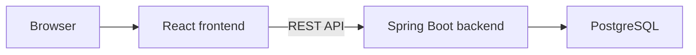

# Coupon Management System — Backend

A Spring Boot API for a full-stack coupon marketplace. The application
supports guest browsing and separate administrator, company, and customer
flows.

[](https://github.com/elad9219/coupons-system-backend/actions/workflows/backend-ci.yml)

| | Link |
| --- | --- |
| Live demo | [Open the application](https://coupons-gamma.vercel.app/) |
| API documentation | [Swagger UI](https://coupons.runmydocker-app.com/swagger-ui.html) |
| Frontend repository | [Coupon System Frontend](https://github.com/elad9219/coupons-system-react) |

> The demo backend may need time to wake up after inactivity. The frontend
> displays a loading message while it waits for the API.

## Application preview

## Screenshots

### Coupon catalog


### Demo sign-in


### Administrator: company management


### Company: coupon management


### Mobile view


## Features

| Area | Capabilities |
| --- | --- |
| Authentication | JWT-based authentication and role checks |
| Guest catalog | Server-side pagination, filtering, and sorting |
| Customers | Registration, coupon purchases, and account management |
| Companies | Coupon creation, updates, deletion, and inventory management |
| Administrators | Company and customer management |
| Data integrity | Input validation, purchase checks, and coupon expiration handling |
| Demo environment | Curated sample data and an explicitly configured reset policy |

The catalog returns a requested page of results instead of requiring the
frontend to download the entire catalog.

## Architecture



The frontend is hosted on Vercel. The containerized backend is hosted on
RunMyDocker and connects to PostgreSQL.

## Technologies

| Technology | Purpose |
| --- | --- |
| Java 21 | Backend language |
| Spring Boot 4.1.2 | Application framework |
| Spring Data JPA and Hibernate | Persistence |
| PostgreSQL | Database |
| JWT | Authentication tokens |
| Spring Security Crypto | Password hashing |
| Springdoc OpenAPI | API documentation |
| Maven | Build and dependency management |
| Docker | Container packaging |
| GitHub Actions | Tests, packaging, and Docker validation |

## Demo accounts

| Role | Email | Password |
| --- | --- | --- |
| Administrator | `admin@admin.com` | `admin` |
| Company | `sony@contact.com` | `1234` |
| Customer | `kobi@gmail.com` | `1234` |

These accounts are intended for the public demo. The demo database is
recreated when the backend restarts, so changes and purchases are temporary.

The initial catalog contains sample companies, customers, coupons, and
purchases. Seeding is skipped when the database already contains data.

## API documentation

Open [Swagger UI](https://coupons.runmydocker-app.com/swagger-ui.html)
to explore the API. The server may need time to start after inactivity.

The public catalog endpoint is:

```text
GET /api/guest/catalog
```

It accepts pagination, category, maximum price, and sorting parameters.
Authenticated operations use the appropriate user role.

## Local development

### Requirements

- Java 21
- Maven
- PostgreSQL
- Node.js 22 and npm for the frontend

### Configure the database

Clone the repository:

```bash
git clone https://github.com/elad9219/coupons-system-backend.git
cd coupons-system-backend
```

Copy the example configuration:

```bash
cp src/main/resources/application.properties.example \
   src/main/resources/application.properties
```

Create a local PostgreSQL database and update the datasource URL, username,
and password in `application.properties`.

For a new, dedicated local development database, set:

```properties
spring.jpa.hibernate.ddl-auto=update
```

The example file defaults to `validate`, which expects an existing schema.
Keep credentials out of version control.

### Configure the JWT signing key

Generate a local key and make it available to the application:

```bash
export COUPONS_JWT_SECRET_BASE64="$(openssl rand -base64 32)"
```

Use a persistent, securely managed secret for an actual deployment. The
generated value must not be committed to the repository.

The default allowed origins include `http://localhost:3000`. If a different
frontend origin is used, configure `COUPONS_ALLOWED_ORIGINS` with the
appropriate explicit origin.

### Run the backend

```bash
mvn spring-boot:run
```

The API is available at `http://localhost:8080`.

To run the user interface locally, follow the
[frontend setup instructions](https://github.com/elad9219/coupons-system-react).

## Tests and build

```bash
mvn clean verify
```

The backend workflow runs tests, packages the application, checks that the
private local configuration is excluded from the JAR, builds a Docker
image, and checks the container's Java runtime and non-root user.

## Public demo reset

The hosted demo uses an isolated, disposable database. Its deployment
configuration enables a schema reset on application startup:

```text
COUPONS_PUBLIC_DEMO=true
COUPONS_DEMO_RESET_ON_STARTUP=true
SPRING_JPA_HIBERNATE_DDL_AUTO=create
```

This reset deletes and recreates the database tables on startup. Use these
settings only with a dedicated demo database that contains no data requiring
preservation. They are not required for normal local development.

Database connection details, the JWT secret, and allowed origins are
configured separately for the deployment.

## Related repository

- [React frontend](https://github.com/elad9219/coupons-system-react)

## Author

**Elad Tennenboim**

- [GitHub](https://github.com/elad9219)
- [LinkedIn](https://www.linkedin.com/in/elad-tennenboim/)
- [Portfolio](https://eladt-portfolio.vercel.app/)
- [Email](mailto:elad9219@gmail.com)